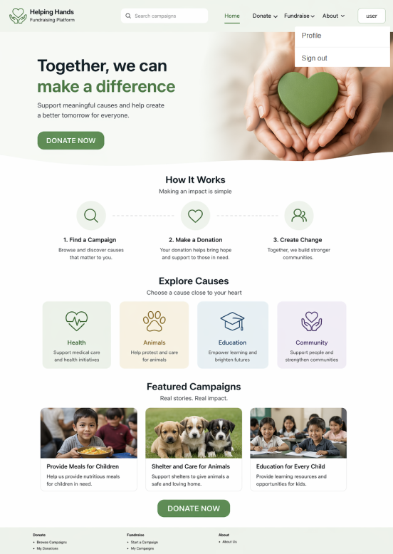
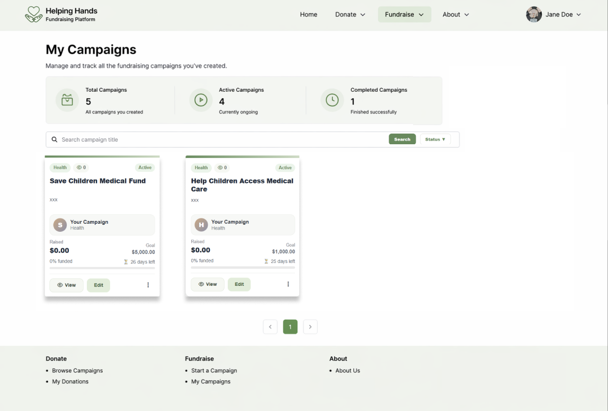
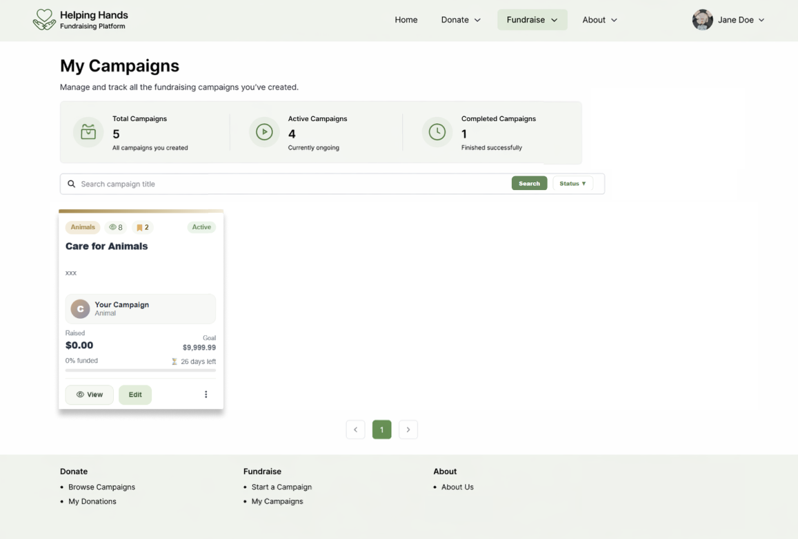
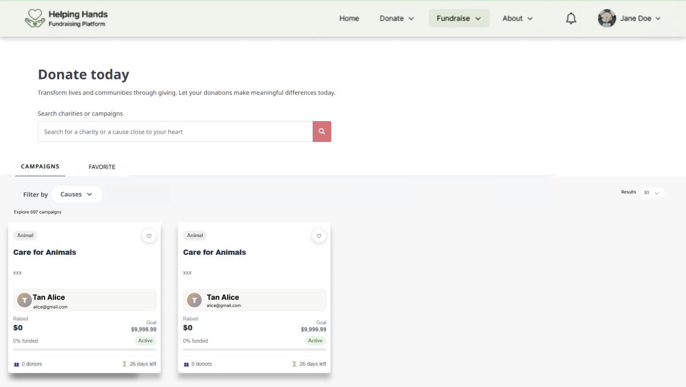
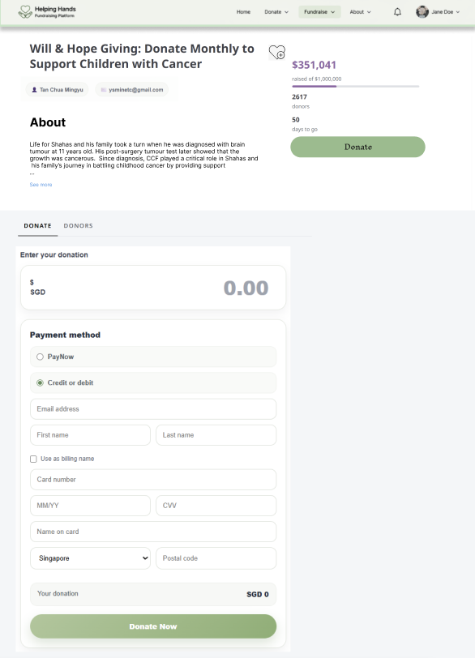
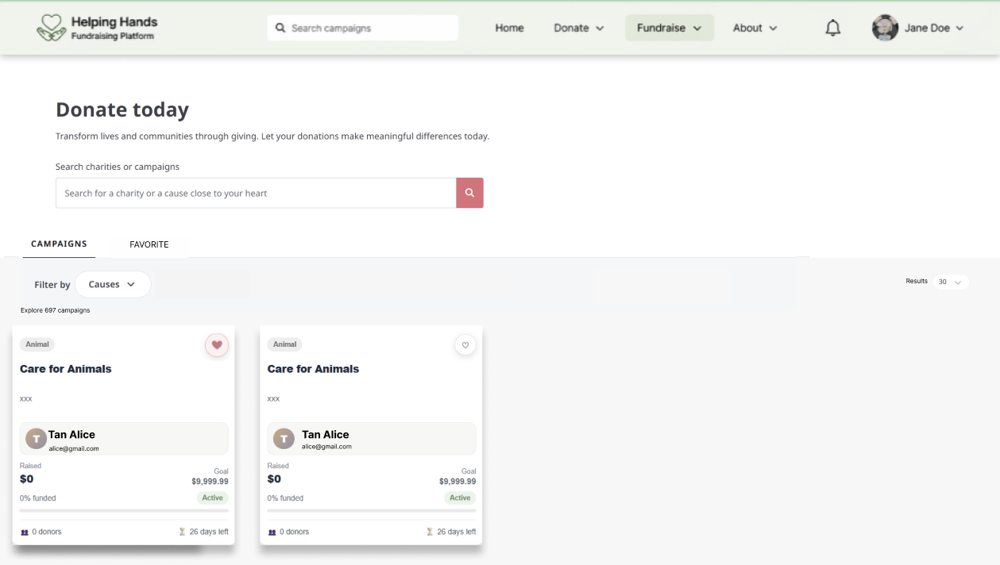
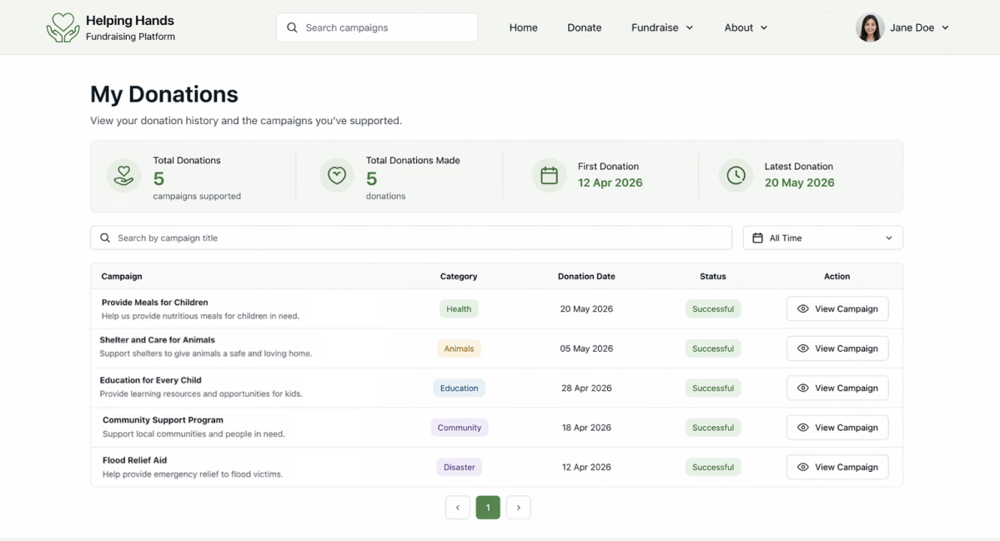
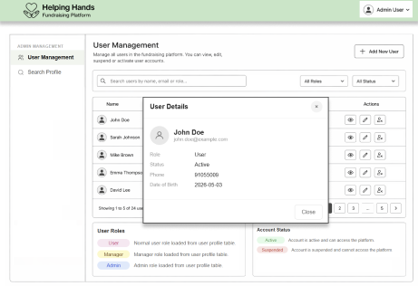
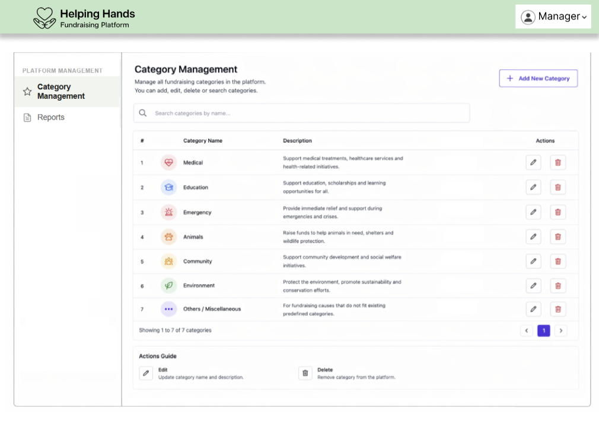
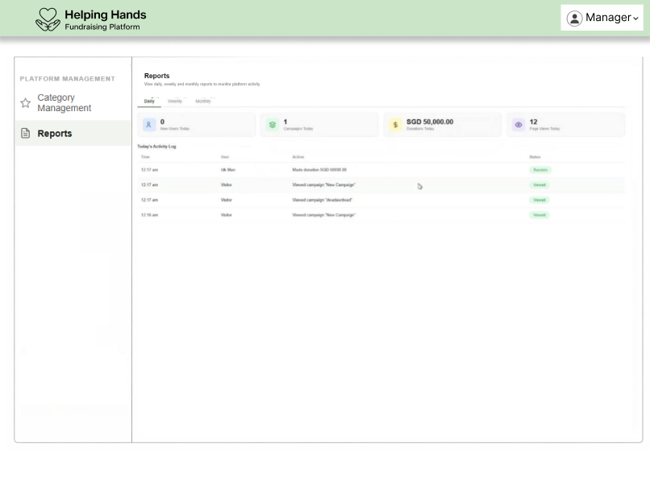

# HelpingHands

A full-stack fundraising web application developed to connect fundraisers with potential supporters through a centralised campaign management platform.

## Overview

HelpingHands provides role-based functionality for managing fundraising campaigns, supporting user engagement and administering platform activities. The system is organised around four user roles, each with access to specific features and operations.

## User Roles & Features

### 1. Fund Raiser
- Create, view, update and delete fundraising campaigns.
- Search and manage existing campaigns.
- Monitor campaign activity through view counts and shortlisted counts.
- Review completed fundraising activities.

### 2. Donee
- Browse and search available fundraising campaigns.
- View campaign details, including fundraising targets, current amounts and progress.
- Add campaigns to favourites and manage saved campaigns.
- View and search donation history.

### 3. User Admin
- Manage user accounts.
- View and update user profile information.

### 4. Platform Manager
- Create, view, update and delete campaign categories.
- Search and manage existing categories.
- Generate and view platform reports.
- Review daily, weekly and monthly statistics covering platform activity, fundraising performance, donations and user traffic.

## System Scope

- **Campaign Management:** Fundraising campaign creation, maintenance and activity tracking.
- **User Management:** Role-based user functionality and account administration.
- **Supporter Engagement:** Campaign discovery, favourites and donation history.
- **Platform Administration:** Campaign category management and activity reporting.

## Screenshots & Application Interface

This section provides an overview of the HelpingHands application interface and its main functionalities across different user roles.

### 1. General Interface

| Homepage | Campaign Listing |
|:---:|:---:|
|  |  |

### 2. Fund Raiser Interface

The Fund Raiser interface provides functionality for creating, managing and monitoring fundraising campaigns.

| Campaign Dashboard |
|:---:|:---:|
|  

| Campaign Details | Activity Tracking |
|:---:|:---:|
|  

### 3. Donee Interface

The Donee interface allows users to discover fundraising campaigns, manage their favourites and review donation history.

| Campaign Discovery | Campaign Details |
|:---:|:---:|
|  |  |

| Favourites | Donation History |
|:---:|:---:|
|  |  |

### 4. Administrative Interface

The administrative interface provides account management and platform-level functionality.

| User Management | Category Management |
|:---:|:---:|
|  |  |

| Platform Dashboard | Activity Reports |
|:---:|:---:|
| 

---

*Note: Screenshots are organised by application functionality and user role. Replace the image paths with the corresponding screenshots available in the repository.*

